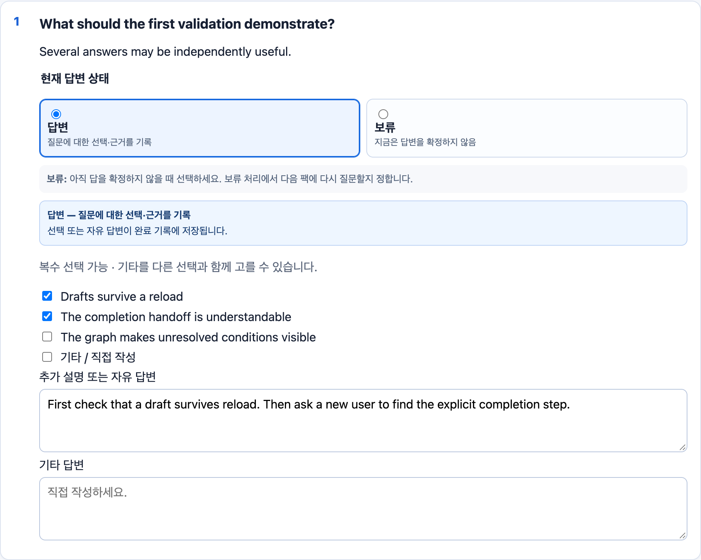
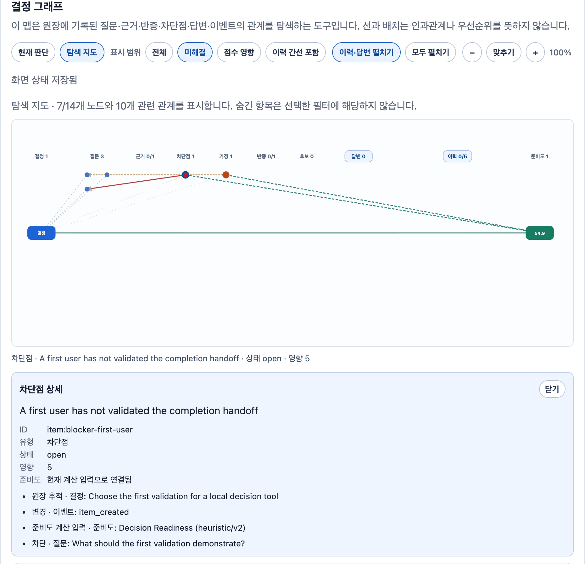

# Whybranch

한국어 · [English](README.md)

**선택하고, 그 이유를 남기세요.**

Whybranch는 사용자와 AI 에이전트가 함께 쓰는 로컬 의사결정 도구입니다. 에이전트가 준비한 질문에 브라우저에서 답하고, 무엇을 선택했는지와 어떤 근거가 남아 있는지를 한 워크스페이스에서 이어 갑니다.

질문, 답변, 가정, 반대 근거, 아직 해결하지 못한 조건을 같은 원장에 기록합니다. 나중에 결정을 다시 살펴볼 때 결론뿐 아니라 그 결론에 이른 과정도 확인할 수 있습니다.

이 한국어 README가 기준 문서입니다. 내용을 바꿀 때는 이 문서를 먼저 수정하고, 같은 변경에서 [영문 README](README.md)를 맞춥니다.



질문 화면에서 선택과 그 이유를 함께 남깁니다.

이 문서의 두 스크린샷은 [공개 예제](examples/first-decision.json)의 가상 데이터와 설명용 답변 초안으로 실제 한국어 UI를 캡처한 것입니다. 실제 사용자의 결정이나 결과가 아닙니다.

## 어떤 때 사용하나요?

- **제품이나 프로젝트의 방향을 정할 때:** 목적과 제약을 확인하고, 바로 결정할 수 있는 부분과 추가 검증이 필요한 부분을 나눕니다.
- **경험을 정리하거나 면접을 준비할 때:** 기록을 바탕으로 질문에 답하면서 실제 경험과 에이전트의 해석을 구분합니다.
- **구현 범위를 합의할 때:** 사용자가 고른 내용, 에이전트에게 맡긴 범위, 아직 결정하지 않은 내용을 확인합니다. 기존 승인과 위임은 재사용합니다.

질문 작성과 답변 해석은 연결한 AI 에이전트가 맡고, Whybranch CLI는 질문 화면과 로컬 기록을 관리합니다. CLI 자체에 AI 모델 호출이나 다음 질문을 자동으로 생성하는 기능은 없습니다.

## 현재 상태

현재 버전은 **`0.1.0-alpha.0`**입니다. 소스 체크아웃에서 실행하는 경로를 제공합니다. npm 게시 여부와 `whybranch` 패키지 이름의 소유권은 확인해야 하므로, 확인 전에는 `npx`로 실행하지 마세요. 공개·배포 준비 사항은 [RELEASING.md](RELEASING.md)에 정리돼 있습니다.

기본 실행 환경은 한 사람이 자신의 컴퓨터에서 사용하는 로컬 워크스페이스입니다. 서버는 `127.0.0.1`에만 연결되며, 계정이나 로그인은 없습니다. 호스팅형 협업 서비스는 제공하지 않습니다.

## 빠르게 시작하기

**Node.js 20 이상**이 필요합니다. 런타임 의존성이 없어 예제를 실행하기 위해 `npm install`을 먼저 할 필요는 없습니다.

저장소 코드를 내려받은 뒤 프로젝트 루트에서 실행합니다.

```sh
git clone https://github.com/omizha/whybranch.git
cd whybranch
node ./bin/whybranch.mjs start --seed-file ./examples/first-decision.json
```

직접 질문 파일을 준비하지 않고 시작하려면 내장된 한국어 면접 질문 묶음을 사용할 수 있습니다.

```sh
node ./bin/whybranch.mjs start --pack interview
```

내장 질문 묶음은 프로젝트에 포함된 선언적 질문 데이터입니다. 실행 가능한 플러그인이 아니며, 사용자 정의 질문과 같은 화면·저장·완료 절차를 사용합니다. 숨겨진 점수 입력도 없습니다.

`start`는 다음과 같은 JSON을 반환합니다. 아래 ID와 포트는 설명용이며, 실제 실행이 반환한 값을 사용해야 합니다.

```json
{
  "workspace_id": "local-workspace-id",
  "url": "http://127.0.0.1:PORT/workspaces/local-workspace-id",
  "revision": 1,
  "ledger_revision": 1
}
```

1. 반환된 `url`을 브라우저에서 엽니다.
2. 질문에 답합니다. 작성 중인 내용은 로컬 초안으로 자동 저장됩니다.
3. 답변을 제출하려면 **`Codex로 계속`**을 누릅니다. 에이전트와 진행 중이라면 채팅에도 **`계속`**이라고 입력합니다. 버튼만 눌러서는 에이전트가 자동으로 재개되지 않습니다.

자동 저장과 답변 제출은 별개입니다. 아직 제출하지 않은 초안을 확정된 답변으로 사용하지 않습니다.

## AI 에이전트와 함께 사용하기

Codex와 Claude Code용 스킬이 포함돼 있습니다. 두 환경은 같은 기준 스킬을 사용하며, 설치 방법은 [에이전트 연동 안내](docs/agent-integrations.md)에 있습니다. 스킬을 설치할 때는 `SKILL.md`와 참고문서가 함께 들어 있는 디렉터리 전체를 복사합니다. CLI는 별도로 사용할 수 있어야 합니다.

설치 후에는 다음처럼 요청할 수 있습니다.

```text
$whybranch 이번 프로젝트에서 가장 먼저 검증할 가정을 함께 정리해 주세요.
```

에이전트는 질문 묶음을 준비하고, 제출된 답변을 읽은 뒤 필요한 후속 질문을 같은 워크스페이스에 표시합니다. 추천, 사용자 선택, 구현 권한을 구분하며, 일반적인 탐색이나 경력 정리에는 구현 승인 기록을 요구하지 않습니다.

## 직접 질문 만들기

질문 파일인 seed는 JSON으로 작성합니다. 아래 내용을 `decision.json`으로 저장하면 됩니다.

```json
{
  "objective": "로컬 의사결정 도구에서 먼저 검증할 것을 정한다",
  "scope": "개발자 한 명의 작업 흐름",
  "horizon": "이번 주",
  "questions": [
    {
      "id": "risk",
      "prompt": "첫 검증에서 어떤 위험을 확인해야 하나요?",
      "kind": "choice",
      "selection_mode": "single",
      "options": [
        { "id": "privacy", "label": "로컬 데이터 취급" },
        { "id": "adoption", "label": "에이전트 작업 흐름과의 적합성" }
      ],
      "allow_other": true
    }
  ],
  "material_items": [
    {
      "id": "assumption-local-only",
      "kind": "assumption",
      "label": "첫 버전은 한 사람이 자신의 컴퓨터에서 사용한다",
      "impact": "high"
    }
  ]
}
```

```sh
node ./bin/whybranch.mjs start --seed-file ./decision.json
```

`questions`는 사용자에게 보여 줄 질문이고, `material_items`는 준비도 계산과 그래프에 반영할 명시적인 가정·근거·반대 근거·해결 조건입니다. 답변을 입력했다고 해서 이 항목들이 자동으로 검증되거나 해소되지는 않습니다. 더 자세한 예시는 [examples/first-decision.json](examples/first-decision.json)을 참고하세요.

## 한 워크스페이스에서 이어 가기

시작할 때 받은 `workspace_id`를 보관합니다. 다음 질문 묶음도 같은 워크스페이스에 표시하고, 결정 세션을 마치면 보관 처리합니다.

```text
start → 답변 작성·자동 저장 → 명시적 제출 → consume
      → 에이전트 검토 → advance로 후속 질문 → … → finish로 보관
```

```sh
# 현재 워크스페이스 상태 확인
node ./bin/whybranch.mjs status --workspace <workspace_id>

# 제출된 답변 읽기
node ./bin/whybranch.mjs consume --workspace <workspace_id>

# 같은 워크스페이스에 다음 질문 표시
node ./bin/whybranch.mjs advance --workspace <workspace_id> --seed-file ./next-pack.json

# 새 가정·근거·반대 근거·해결 조건 추가
node ./bin/whybranch.mjs add-item --workspace <workspace_id> --item-file ./examples/new-blocker.json

# 기존 항목의 근거나 해석 정정
node ./bin/whybranch.mjs amend-item --workspace <workspace_id> --item <item_id> --patch-file ./examples/validate-assumption.patch.json

# 근거가 부족한 추론을 표시하고 다시 계산
node ./bin/whybranch.mjs flag-inference --workspace <workspace_id> --item <item_id> --reason "The cited evidence does not support this inference."

# 기존 워크스페이스 재개 또는 검증 가능한 기록에서 복구
node ./bin/whybranch.mjs recover --workspace <workspace_id>

# 서버를 종료하고 기록을 삭제하지 않은 채 보관
node ./bin/whybranch.mjs finish --workspace <workspace_id>
```

`advance`는 워크스페이스 ID와 URL을 유지하면서 질문 묶음의 revision을 올립니다. 범위가 실질적으로 달라질 때만 seed의 `scope_version`을 바꿉니다. 이 경우 `scope_changed` 이벤트와 범위를 다시 확인해야 한다는 조건이 기록되며, 재검증 전까지 남은 불확실성이 커질 수 있습니다.

`start` 뒤, 한 차례 에이전트 작업에서 원장을 마지막으로 바꾼 뒤, `advance` 전에는 `status`로 ID·URL·revision·ledger revision·단계를 확인합니다. URL이 열리지 않으면 기존 ID부터 확인합니다. `recover`는 같은 워크스페이스를 재개하지만 포트 사정에 따라 URL이 바뀔 수 있으므로, 복구 결과가 반환한 URL을 사용합니다.

## 준비도와 그래프 읽기

**`Decision Readiness (heuristic/v2)`**는 현재 원장과 공개된 계산 규칙을 바탕으로 만드는 검토 지표입니다. 성공 확률, 예측, 추천, 신뢰도 또는 사용자의 확신 정도를 뜻하지 않습니다. 같은 원장과 같은 규칙 버전에서는 같은 점수와 그래프가 나옵니다.

새 반대 근거나 중요한 미해결 조건이 추가되면 준비도가 낮아질 수 있습니다. **남은 불확실성**인 `unresolved_burden`도 원장에 기록된 항목으로 계산하며, 현실의 불확실성을 확률로 측정한 값은 아닙니다. 점수 변경에는 규칙 버전, 적용 규칙, 관련 항목과 이유가 기록됩니다.

그래프는 어떤 기록이 질문과 결정을 뒷받침하거나 가로막는지 살펴보는 화면입니다. 배치나 연결선 자체가 인과관계를 증명하지는 않습니다. 후보를 다시 검토하는 상태는 후보 관련 항목과 그래프에 반영되며, 그 상태 변경만으로 전체 준비도가 내려가는 것은 아닙니다.



그래프에서 아직 해결하지 못한 항목과 각 항목의 상세 정보를 확인합니다.

잘못된 전제가 있다면 점수를 직접 고치지 않고 `add-item`, `amend-item`, `flag-inference`로 관련 기록을 정정합니다. 이미 제출된 답변은 보존하고, 사용자의 답이 바뀌면 후속 질문으로 남깁니다.

연동 개발을 위해 `decision-semantics/v1` 의미 계약도 내보냅니다. 항목·응답·이벤트·노드·관계의 현재 어휘를 설명하며, 필수 필드와 허용 값은 런타임 검증기가 확인합니다. 자세한 내용은 [의미 계약](docs/decision-semantics.md)과 [점수·그래프 설명](docs/score-and-graph.md)을 참고하세요.

## 데이터는 어디에 저장되나요?

Whybranch CLI는 질문 파일, 초안, 답변, 원장과 복구·보관 기록을 로컬에 저장하며 외부 서비스로 전송하지 않습니다. 연결한 AI 에이전트가 답변을 처리하는 방식은 해당 에이전트의 실행 환경과 데이터 정책을 따릅니다. Whybranch는 계정, 클라우드 동기화, 원격 협업이나 사용자 분석 서비스를 제공하지 않습니다.

기본 상태 저장 경로는 다음과 같습니다.

| 운영체제 | 경로 |
| --- | --- |
| macOS | `~/Library/Application Support/whybranch` |
| Linux | `${XDG_STATE_HOME:-~/.local/state}/whybranch` |
| Windows | `%LOCALAPPDATA%/whybranch` |

`WHYBRANCH_WORKSPACE_ROOT`로 경로를 지정할 수 있습니다. 같은 세션의 명령에는 같은 설정을 사용해야 합니다. 이 변수가 없으면 이전 이름인 `DGI_WORKSPACE_ROOT`도 인식합니다. 기존 워크스페이스는 ID로 이전 저장 위치에서 찾아 그대로 사용하며, 이름 변경만으로 이동하거나 원장을 다시 쓰지 않습니다. [이름 변경 호환성](docs/local-data.md#rename-compatibility)을 참고하세요.

정상적인 저장은 복구 복제본도 갱신하고, 질문 묶음이 전환되는 경계에는 변경하지 않는 체크포인트를 남깁니다. 복구 복제본까지 검증되지 않으면 `storage_health.status`가 `degraded`로 표시됩니다. 이때는 추가 변경을 멈추고 같은 ID에 대해 `status`와 `recover`로 상태를 확인합니다. 채팅 요약이나 파생 문서는 원본 원장의 백업을 대신하지 않습니다.

워크스페이스는 그래프 보기·필터·접힌 그룹·선택한 노드·확대 및 이동 상태 등 화면 설정도 보존합니다. 이전 revision의 화면이 저장을 시도하면 `409`로 거부합니다. 아직 서버에 도착하지 않은 마지막 입력은 보존되지 않을 수 있으므로 저장 완료 상태를 확인하세요. 초안 저장 지연은 450ms, 화면 설정 저장 지연은 300ms입니다. 창 위치, 스크롤, 포커스, 방문 기록이나 화면 픽셀 전체를 복원하는 기능은 아닙니다.

`finish`는 서버를 종료하고 기록을 보관하며 삭제하지 않습니다. CLI에는 영구 삭제 명령이 없습니다. `recover`는 보관 기록이나 검증된 복구 복제본·체크포인트로 같은 ID를 재개합니다. `recovered_from`, `recovery_exact`, `recovery_warning`을 확인하세요. 체크포인트에서 복구하면 이후에 저장한 내용이 빠질 수 있으며, 이를 최신 상태의 완전 복구로 간주하면 안 됩니다.

서버는 로그인 없이 로컬에서 한 사람이 사용하는 범위로 제한됩니다. LAN 주소나 공개 포트·터널로 노출하거나 워크스페이스 디렉터리를 공유하지 마세요. 로컬 URL 자체가 사용자별 접근 권한을 보장하지는 않습니다. 브라우저의 변경 요청은 JSON을 사용해야 하며, 다른 출처가 명시된 요청은 거부합니다. 동시에 발생하는 로컬 변경은 파일 잠금으로 직렬화합니다. 자세한 범위와 복구 절차는 [로컬 데이터 안내](docs/local-data.md)에 있습니다.

## 개발과 기여

개발 환경을 준비하고 변경 사항을 확인하려면 다음 명령을 실행합니다.

```sh
npm ci --ignore-scripts
npm test
npm run lint
npm run check
npm run pack:dry-run
```

README를 수정할 때는 **한국어 먼저, 영어 반영** 순서로 진행합니다. 두 문서의 구성, 명령 예시, 기능 설명과 제한 사항을 같은 변경에서 맞춥니다.

| 문서 | 내용 |
| --- | --- |
| [CONTRIBUTING.md](CONTRIBUTING.md) | 개발 환경과 기여 기준 |
| [SECURITY.md](SECURITY.md) | 보안 범위와 취약점 제보 |
| [CODE_OF_CONDUCT.md](CODE_OF_CONDUCT.md) | 참여자 행동 강령 |
| [RELEASING.md](RELEASING.md) | 공개·배포 준비 |
| [CHANGELOG.md](CHANGELOG.md) | 버전별 변경 사항 |
| [docs/architecture.md](docs/architecture.md) | 내부 구조 |

## 라이선스

[MIT License](LICENSE)를 따릅니다.
