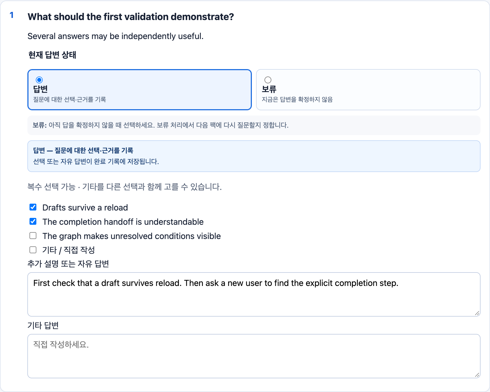
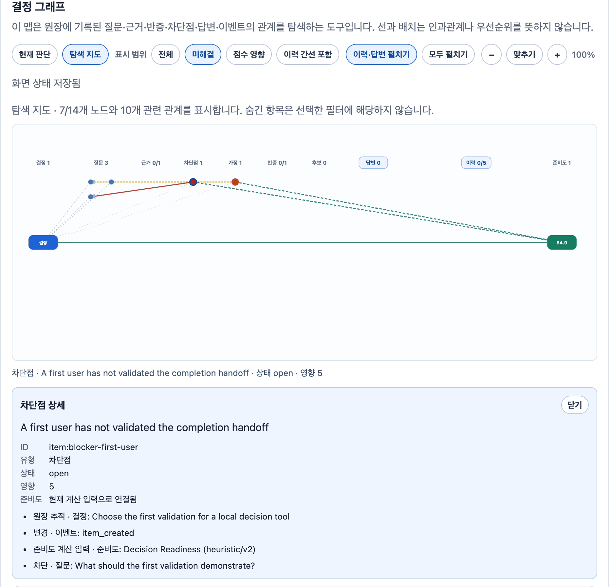

# Whybranch

[한국어](README.ko.md) · English

**Make a choice. Keep the reasons.**

Whybranch is a local decision tool for a user and an AI agent to use together. Answer questions prepared by the agent in your browser, and keep track of your choices and the evidence behind them in one workspace.

Questions, answers, assumptions, counter-evidence, and unresolved conditions share the same ledger. When you revisit a decision, you can review both the conclusion and how you reached it.

The [Korean README](README.ko.md) is the authoritative version. When making changes, update it first and bring this English version into alignment in the same change.



Record your choices and the reasons behind them in the question interface.

Both screenshots in this document show the real Korean UI using synthetic data from the [public example](examples/first-decision.json) and illustrative draft answers. They do not represent an actual user's decisions or outcomes.

## When should I use it?

- **Choosing a direction for a product or project:** Clarify goals and constraints, then separate what you can decide now from what needs more validation.
- **Reviewing your experience or preparing for an interview:** Answer questions using your records while keeping actual experience separate from the agent's interpretation.
- **Agreeing on implementation scope:** Review what the user has chosen, what they have delegated to the agent, and what remains undecided. Reuse existing approvals and delegations.

The connected AI agent writes questions and interprets answers. The Whybranch CLI manages the question interface and local records. The CLI itself does not call AI models or automatically generate follow-up questions.

## Current status

The current version is **`0.1.0-alpha.0`**. You can run it from a source checkout. npm publication and ownership of the `whybranch` package name must be verified before relying on `npx`; do not use `npx` until then. See [RELEASING.md](RELEASING.md) for publication and release preparation.

The default environment is a local workspace used by one person on their own computer. The server binds only to `127.0.0.1`, with no accounts or login. It is not a hosted collaboration service.

## Quick start

You need **Node.js 20 or later**. There are no runtime dependencies, so you do not need to run `npm install` before trying the examples.

Clone the repository, then run this from the project root:

```sh
git clone https://github.com/omizha/whybranch.git
cd whybranch
node ./bin/whybranch.mjs start --seed-file ./examples/first-decision.json
```

To start without preparing a question file, use the built-in Korean interview question pack:

```sh
node ./bin/whybranch.mjs start --pack interview
```

The built-in pack is declarative question data included in the project. It is not an executable plugin. It uses the same interface, storage, and completion process as custom questions, with no hidden scoring inputs.

`start` returns JSON like the following. The ID and port below are illustrative; use the values returned by your actual run.

```json
{
  "workspace_id": "local-workspace-id",
  "url": "http://127.0.0.1:PORT/workspaces/local-workspace-id",
  "revision": 1,
  "ledger_revision": 1
}
```

1. Open the returned `url` in your browser.
2. Answer the questions. Your work is saved automatically as a local draft.
3. To submit your answers, click **`Codex로 계속`** (Continue with Codex). If you are working with an agent, also type **`계속`** (Continue) in the chat. Clicking the button alone does not automatically resume the agent.

Autosaving and submitting answers are separate actions. Unsubmitted drafts are not treated as confirmed answers.

## Using it with an AI agent

Skills for Codex and Claude Code are included. Both use the same canonical skill; see the [agent integration guide](docs/agent-integrations.md) for installation instructions. Copy the entire skill directory, including `SKILL.md` and its reference documents. The CLI must also be available separately.

After installation, you can ask:

```text
$whybranch Help me identify which assumptions to validate first for this project.
```

The agent prepares a question pack, reads submitted answers, and presents any needed follow-up questions in the same workspace. It keeps recommendations, user choices, and implementation authority separate. Ordinary exploration and career reflection do not require an implementation approval record.

## Writing your own questions

A seed is a JSON question file. Save the following as `decision.json`:

```json
{
  "objective": "Decide what to validate first in a local decision tool",
  "scope": "One developer's workflow",
  "horizon": "This week",
  "questions": [
    {
      "id": "risk",
      "prompt": "Which risk should the first validation address?",
      "kind": "choice",
      "selection_mode": "single",
      "options": [
        { "id": "privacy", "label": "Local data handling" },
        { "id": "adoption", "label": "Fit with the agent workflow" }
      ],
      "allow_other": true
    }
  ],
  "material_items": [
    {
      "id": "assumption-local-only",
      "kind": "assumption",
      "label": "The first version is used by one person on their own computer",
      "impact": "high"
    }
  ]
}
```

```sh
node ./bin/whybranch.mjs start --seed-file ./decision.json
```

`questions` contains the questions shown to the user. `material_items` contains explicit assumptions, evidence, counter-evidence, and resolution conditions used in readiness calculations and the graph. Entering answers does not automatically validate or resolve these items. See [examples/first-decision.json](examples/first-decision.json) for a more detailed example.

## Continuing in one workspace

Keep the `workspace_id` returned at startup. Present subsequent question packs in the same workspace, then archive it when the decision session is complete.

```text
start → write answers and autosave → explicit submission → consume
      → agent review → follow-up questions with advance → … → archive with finish
```

```sh
# Check the current workspace state
node ./bin/whybranch.mjs status --workspace <workspace_id>

# Read submitted answers
node ./bin/whybranch.mjs consume --workspace <workspace_id>

# Show the next questions in the same workspace
node ./bin/whybranch.mjs advance --workspace <workspace_id> --seed-file ./next-pack.json

# Add assumptions, evidence, counter-evidence, or resolution conditions
node ./bin/whybranch.mjs add-item --workspace <workspace_id> --item-file ./examples/new-blocker.json

# Correct the evidence or interpretation of an existing item
node ./bin/whybranch.mjs amend-item --workspace <workspace_id> --item <item_id> --patch-file ./examples/validate-assumption.patch.json

# Flag an unsupported inference and recalculate
node ./bin/whybranch.mjs flag-inference --workspace <workspace_id> --item <item_id> --reason "The cited evidence does not support this inference."

# Resume an existing workspace or recover from verifiable records
node ./bin/whybranch.mjs recover --workspace <workspace_id>

# Stop the server and archive exact state of the records without deleting them
node ./bin/whybranch.mjs finish --workspace <workspace_id>
```

`advance` increments the question pack revision while keeping the workspace ID and URL. Change the seed's `scope_version` only when the scope materially changes. This records a `scope_changed` event and a requirement to reconfirm the scope; the unresolved burden may increase until revalidation.

Use `status` to check the ID, URL, revision, ledger revision, and phase after `start`, after the final ledger mutation in an agent turn, and before `advance`. If the URL does not open, check the existing ID first. `recover` resumes the same workspace, but its URL may change depending on port availability. Use the URL returned by recovery.

## Reading readiness and the graph

**`Decision Readiness (heuristic/v2)`** is a review indicator derived from the current ledger and published calculation rules. It is not a success probability, prediction, recommendation, confidence score, or measure of the user's certainty. The same ledger and rule version produce the same score and graph.

Readiness may decrease when new counter-evidence or important unresolved conditions are added. The **remaining uncertainty**, `unresolved_burden`, is also calculated from recorded ledger items; it is not a probabilistic measurement of uncertainty in the real world. Score changes record the rule version, applied rules, relevant items, and reasons.

The graph lets you inspect which records support or block questions and decisions. Layout and connecting lines do not establish causality. A candidate's reconsideration state is reflected in candidate-related items and the graph; that state change alone does not reduce overall readiness.



Inspect unresolved items and their details in the graph.

If a premise is wrong, correct the relevant records with `add-item`, `amend-item`, or `flag-inference` instead of editing the score directly. Preserve submitted answers and record a changed user answer through a follow-up question.

For integration development, Whybranch also exports the `decision-semantics/v1` semantic contract. It describes the current vocabulary for items, responses, events, nodes, and relations, while runtime validators check required fields and allowed values. See the [semantic contract](docs/decision-semantics.md) and [score and graph guide](docs/score-and-graph.md) for details.

## Where is data stored?

The Whybranch CLI stores question files, drafts, answers, the ledger, and recovery and archive records locally. It does not send them to external services. How a connected AI agent processes answers depends on that agent's execution environment and data policy. Whybranch does not provide accounts, cloud sync, remote collaboration, or user analytics services.

Default state locations:

| Operating system | Path |
| --- | --- |
| macOS | `~/Library/Application Support/whybranch` |
| Linux | `${XDG_STATE_HOME:-~/.local/state}/whybranch` |
| Windows | `%LOCALAPPDATA%/whybranch` |

You can override the path with `WHYBRANCH_WORKSPACE_ROOT`. Use the same setting for all commands in a session. If this variable is absent, the former name, `DGI_WORKSPACE_ROOT`, is also recognized. Existing workspaces are located by ID in their previous storage locations and used in place. The rename alone does not move workspaces or rewrite their ledgers. See [rename compatibility](docs/local-data.md#rename-compatibility).

Successful saves also update recovery replicas, and transitions between question packs create immutable checkpoints. If recovery replicas cannot also be verified, `storage_health.status` is reported as `degraded`. Stop further mutations and check the same ID with `status` and `recover`. Chat summaries and derived documents do not replace a backup of the original ledger.

The workspace also preserves display settings, including graph view, filters, collapsed groups, selected nodes, and zoom and pan state. Save attempts from a page with an older revision are rejected with `409`. The latest input may not be preserved if it has not yet reached the server, so check that saving has completed. Draft saves have a 450ms delay; display settings have a 300ms delay. This does not restore window position, scrolling, focus, browsing history, or every pixel of the screen.

`finish` stops the server and archives records without deleting them. The CLI has no permanent deletion command. `recover` resumes the same ID from archived records, verified recovery replicas, or checkpoints. Check `recovered_from`, `recovery_exact`, and `recovery_warning`. Recovery from a checkpoint may omit later saves and must not be treated as a complete recovery of the latest state.

The server is limited to local use by one person, without login. Do not expose it through a LAN address, public port, or tunnel, or share the workspace directory. A local URL alone does not enforce access permissions per user. Browser mutation requests must use JSON, and requests that explicitly specify a different origin are rejected. Concurrent local mutations are serialized with file locks. See the [local data guide](docs/local-data.md) for the full scope and recovery procedures.

## Development and contributing

To set up a development environment and check your changes, run:

```sh
npm ci --ignore-scripts
npm test
npm run lint
npm run check
npm run pack:dry-run
```

For README changes, **update Korean first, then align English**. Keep the structure, command examples, feature descriptions, and limitations consistent across both documents in the same change.

| Document | Contents |
| --- | --- |
| [CONTRIBUTING.md](CONTRIBUTING.md) | Development setup and contribution guidelines |
| [SECURITY.md](SECURITY.md) | Security scope and vulnerability reporting |
| [CODE_OF_CONDUCT.md](CODE_OF_CONDUCT.md) | Contributor code of conduct |
| [RELEASING.md](RELEASING.md) | Publication and release preparation |
| [CHANGELOG.md](CHANGELOG.md) | Changes by version |
| [docs/architecture.md](docs/architecture.md) | Internal architecture |

## License

Licensed under the [MIT License](LICENSE).
